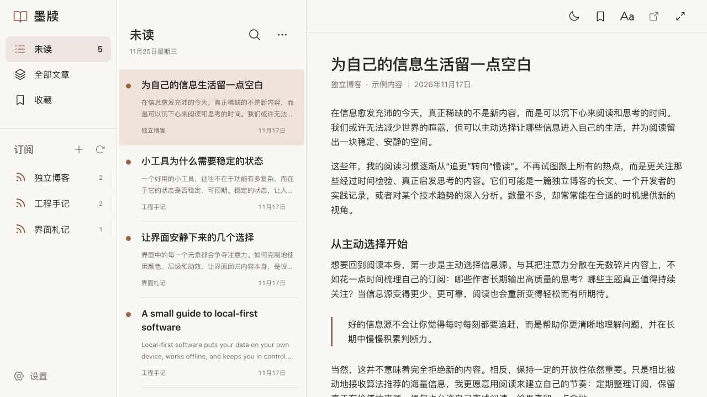
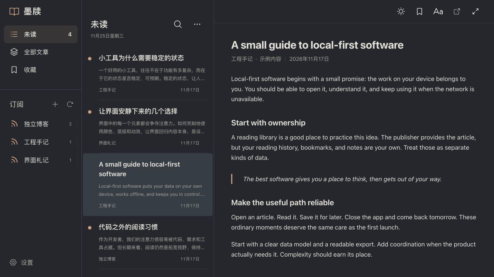

# Modu · 墨牍

[简体中文](README.zh-CN.md)

Modu is a local-first RSS reader for macOS. Follow the blogs and tech publications you enjoy, then read them in one place.



## Get Modu

**Requires an Apple Silicon Mac with macOS 12 or later.**

Download the DMG from the [latest release](https://github.com/Yunz93/Modu/releases/latest) and drag `墨牍.app` into Applications. The app has not been notarized by Apple.

To install from Terminal, quit any running copy of Modu with ⌘Q and run:

```sh
(set -o pipefail; curl -fsSL https://raw.githubusercontent.com/Yunz93/Modu/main/scripts/install-macos.sh | /bin/bash)
```

The script verifies the download and installs the app in Applications. Your reading library stays in place. To update from the app, open **Settings → About & updates**.

## Features

- **Manage your subscriptions.** Add RSS or Atom feeds, discover feeds from a website URL, and import or export OPML with folders. Five technology feeds are ready to refresh in a new library, including Trend Weekly (潮流周刊).
- **Find and finish articles.** Browse in three panes, search the current list or your whole library, bookmark articles, and pick up where you left off. Focus mode gives the article more room.
- **Read technical content comfortably.** Fetch the full article on demand when a feed offers an excerpt. Read code with syntax highlighting and one-click copying, view formulas and images, and play supported audio and video.
- **Set your own reading style.** Choose a light or dark theme and an accent color. Set interface and reading fonts independently. The interface is available in English and Simplified Chinese.
- **Keep your library on your Mac.** Read cached articles offline and export a full backup, including subscriptions, bookmarks, and reading progress.



## License

Modu is released under the [Apache License 2.0](LICENSE). See the [third-party notices](THIRD_PARTY_NOTICES.md) and [release notes](CHANGELOG.md).
