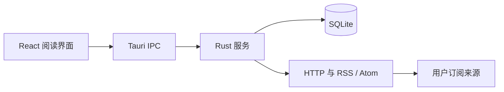

# 墨牍产品与桌面实现

状态：macOS 桌面版 0.1.1 已实现，加入命名迁移与签名更新；当前验收进度见 VALIDATION.md。日期：2026-11-18。

## 用户与范围

macOS 优先，集中订阅博客与技术资讯，安静阅读。核心路径是添加来源、获取文章、阅读与收藏、关闭后继续。单设备本地使用，无需账号；不包含 AI、跨设备同步、推荐流、全文提取、RSSHub 服务；应用内更新见 docs/UPDATER.md。

保留选定的经典三栏布局。明暗配色以用户提供的墨知截图为准：金属灰 #24272c、深色强调色 #d49b7e；纸质白 #faf8f4、浅色强调色 #a65f44。支持主题色与界面、正文的已安装字体名称自定义。桌面首次打开为空库，默认金属灰；恢复时保留备份中的外观选择。

## 实现边界

React + TypeScript + Vite 负责交互，Tauri 2 连接 Rust 原生服务。Rust 使用 reqwest、feed-rs 和 SQLite 完成抓取、订阅发现、解析与存储。浏览器预览继续使用 localStorage 和文件导入，真实联网功能仅桌面可用。

- 订阅 URL 支持直接 RSS / Atom，或读取网页声明的 alternate 订阅链接。单次请求超时 20 秒，重定向最多 8 次，内容上限 8 MB。只接受 HTTP(S)，拒绝 URL 内的账户密码。
- 文章按来源内 GUID / Atom ID 识别，缺省时使用原文链接或内容哈希；重复刷新保留已有文章 ID。正文内容与用户的已读、收藏、阅读位置分别保存。
- 手动刷新顺序处理来源，结果通过“点击载入”展示，不自动替换当前正文。没有 ETag 条件请求、后台订阅轮询或并发抓取。
- SQLite 使用 WAL 与事务。用户状态通过单写队列保存，等待中的快照合并为最新值；revision 拒绝旧写入。关闭窗口、⌘W、⌘Q 等待队列落盘，失败时保留窗口和错误提示。
- 读取失败显示重试页，不建立可写空库。恢复备份先保存恢复前 JSON，再事务替换；失败保留原库。取消订阅只归档来源，保留缓存和收藏。
- RSS / Atom / OPML 文件导入上限 5 MB；完整备份使用原生文件对话框，上限 128 MB。浏览器完整 JSON 备份可以迁入桌面版，浏览器原库继续保留。
- 正文 HTML 清理后显示，远程图片不加载。外部原文与链接交给默认浏览器，禁止远程页面导航进主 WebView。

数据库：`~/Library/Application Support/com.yunz.modu/library.sqlite3`，恢复前备份：同目录 `backups/`。可用 `SHIDU_DATA_DIR` 为开发验收指定独立目录。

## 交付和验证

通过类型检查、11 项前端测试、6 项 Rust 测试、4 项 Sites 模板测试、生产构建。实际 WKWebView 验收包括迁移浏览器备份、tw93 真实抓取、网页自动发现、去重、收藏、字体和主题保存、关闭重开后恢复正文位置、原生导出和默认浏览器打开原文。独立损坏数据库启动试验显示错误页，原文件逐字节保留。

详细证据见 [验证记录](../VALIDATION.md)。交付 Apple Silicon `.app`、`.dmg`、`.zip` 与 SHA-256 校验文件；本地 ad-hoc 签名，未做公开发行公证、Intel 构建、安装升级、全量 IME / VoiceOver 或海量阅读库性能验收。

0.1.1 新增：签名应用内更新、静默检查与跳过版本、安装前最终保存和更新前备份；旧拾读库使用 WAL 一致快照迁入墨牍。详见 [更新协议](UPDATER.md) 与 [墨知实践采用记录](mozi-practice-adoption.md)。
